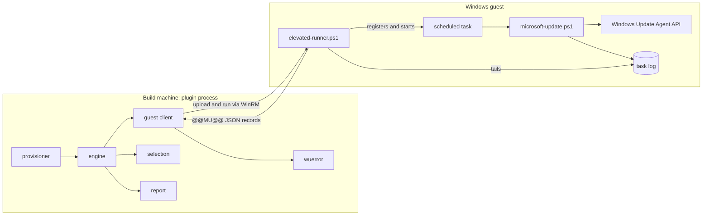
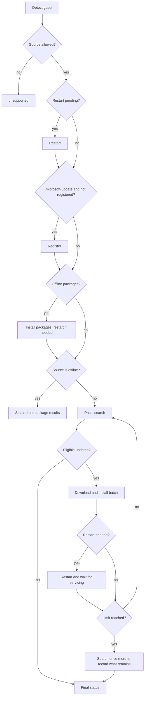

# Architecture

The plugin has two halves: Go code that runs in the Packer plugin process on the
build machine, and two PowerShell scripts that run on the guest. They talk through
the Packer communicator only; the guest needs no agent and no inbound port beyond
the one the communicator already uses.

## Packages

| Package              | Responsibility                                                                                                                                                                                                           |
| -------------------- | ------------------------------------------------------------------------------------------------------------------------------------------------------------------------------------------------------------------------ |
| `provisioner`        | Packer interface: decodes and validates the HCL configuration, applies defaults, maps it to engine settings, prints the summary, writes the report, decides whether the build fails.                                     |
| `internal/engine`    | The update loop: detection, source checks, Microsoft Update registration, offline packages, passes, restarts, retries, and the final status. Talks to the guest through an interface, so it is tested with a fake guest. |
| `internal/guest`     | Guest client: uploads the scripts, runs each action in a scheduled task, parses the output, enforces phase timeouts, restarts the guest, and cleans up. Also holds the embedded scripts and the wire protocol.           |
| `internal/selection` | Pure decision logic: profiles, classifications, include and exclude lists, title patterns.                                                                                                                               |
| `internal/report`    | Report model, JSON writer, and the embedded JSON Schema.                                                                                                                                                                 |
| `internal/wuerror`   | Table of Windows Update, WinHTTP, CBS, and Win32 HRESULTs with names, descriptions, hints, and a class that drives retries.                                                                                              |
| `version`            | Plugin version, set at release time by GoReleaser.                                                                                                                                                                       |

## Why a scheduled task

The Windows Update Agent refuses to download or install from a remote session:
calls made directly over WinRM fail with `E_ACCESSDENIED` (`0x80070005`). The plugin therefore runs every Windows Update Agent
call in a scheduled task with the highest run level, as `SYSTEM` by default, or
as `username` with its password.

For each action the client:

1. uploads `microsoft-update.ps1` once per boot to
   `%SystemRoot%\Temp\packer-microsoft-update-<run id>\`,
2. uploads a request file with the action and its parameters, each value Base64
   encoded so no quoting reaches the guest's command line,
3. uploads a runner script rendered from `elevated-runner.ps1`,
4. runs the runner with `powershell.exe -File` over the communicator.

The runner registers a task named `packer-microsoft-update-<run id>-<number>`,
starts it, and copies new lines from the task's log file to its own output every
second. Every 60 seconds it also writes a heartbeat with CPU and memory load. When
the task ends, it deletes the task, the log, and the request file, and writes a
footer with the task's exit code. The runner deletes its own file when it starts,
so the password in it is on disk only between upload and start.

The task's execution time limit is the sum of the phase timeouts plus one hour, so
Task Scheduler stops a task that the plugin lost track of.

## Wire protocol

The guest script writes one JSON object per line, prefixed with `@@MU@@ `:

| Record                     | Purpose                                                                                                      |
| -------------------------- | ------------------------------------------------------------------------------------------------------------ |
| `log`                      | Message with level `debug`, `info`, `warning`, or `error`.                                                   |
| `phase`                    | Start of a phase: `search`, `download`, `install`, `offline`, or `servicing-wait`. Restarts the phase timer. |
| `heartbeat`                | CPU and memory load, written by the runner.                                                                  |
| `system`                   | Detection result.                                                                                            |
| `search`, `update`         | Search result and one record per update.                                                                     |
| `install`, `update-result` | Install result and one record per update and phase.                                                          |
| `registration`             | Microsoft Update registration result.                                                                        |
| `offline-result`           | Result of one offline package.                                                                               |
| `pending-reboot`           | Pending restart state and whether servicing became idle.                                                     |
| `error`                    | Unhandled error with HRESULT, message, and script position.                                                  |
| `done`                     | The action completed.                                                                                        |

The runner's footer uses the prefix `@@MU-RUNNER@@ `. Output without a prefix is
logged at debug level, or as a warning when it came from standard error.

An action succeeded only when the footer arrived, no `error` record was written,
and a `done` record was written. Anything else becomes a typed error that the
engine classifies for retries.

## Timeouts

A phase watcher starts with a ten-minute startup limit and switches to the limit of
each phase when a `phase` record arrives. When a limit expires, the client cancels
the command, stops and deletes the scheduled task with a separate command, and
returns a timeout error. Commands that the client runs directly, such as reading
the boot time, have a five-minute limit.

## Engine flow

Every guest call goes through a retry wrapper. Transient errors are retried up to
`max_retries` times with exponential backoff starting at `retry_delay` and capped
at five minutes. Before each retry after a lost connection or timeout, the engine
compares the guest's boot time to detect an unexpected restart.

At the end, an update that was attempted but is no longer offered is marked
`superseded` rather than `failed` or `remaining`.

## Cleanup

`detect`, the first action of every run, deletes scheduled tasks left by earlier
runs that start with `packer-microsoft-update-` and are not running. When the run
ends, the client deletes its work directory on the guest.

## Compatibility constraints on the guest scripts

The guest scripts run on Windows PowerShell 2.0 (Windows 7 SP1 and Windows Server
2008 R2) up to 5.1. They use `Set-StrictMode -Version 2.0`, WMI rather than CIM
cmdlets, COM for Task Scheduler and the Windows Update Agent, and their own JSON
writer, because `ConvertTo-Json` does not exist in PowerShell 2.0. The Pester
tests in `test/guest/Compatibility.Tests.ps1` check that no newer syntax or cmdlet
slips in.
